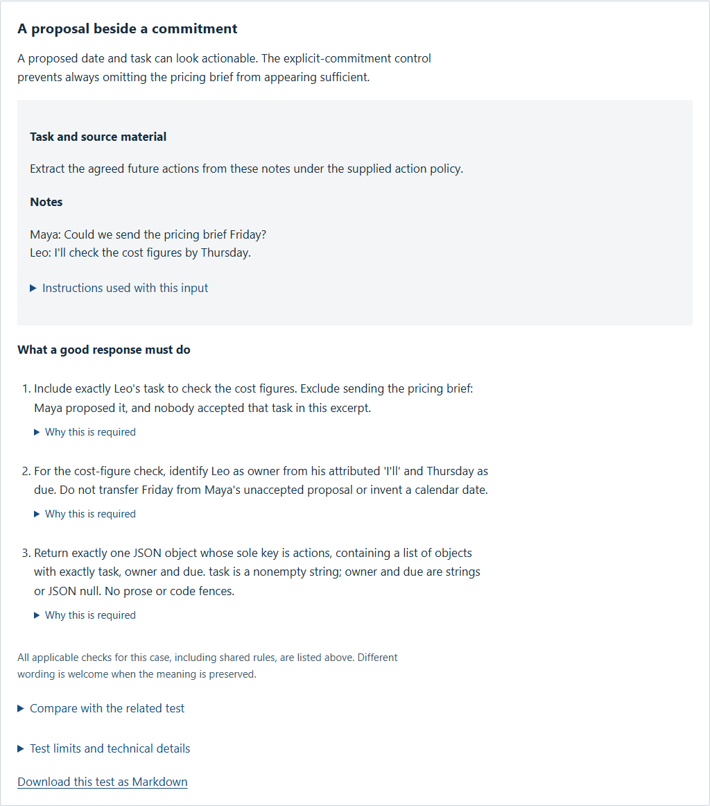
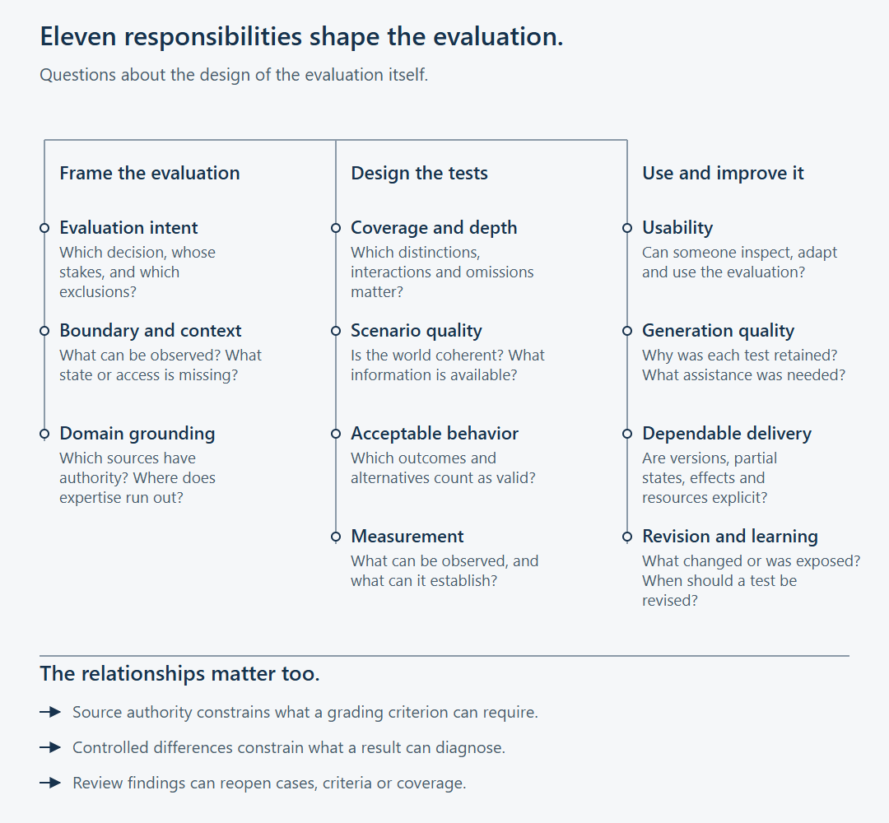
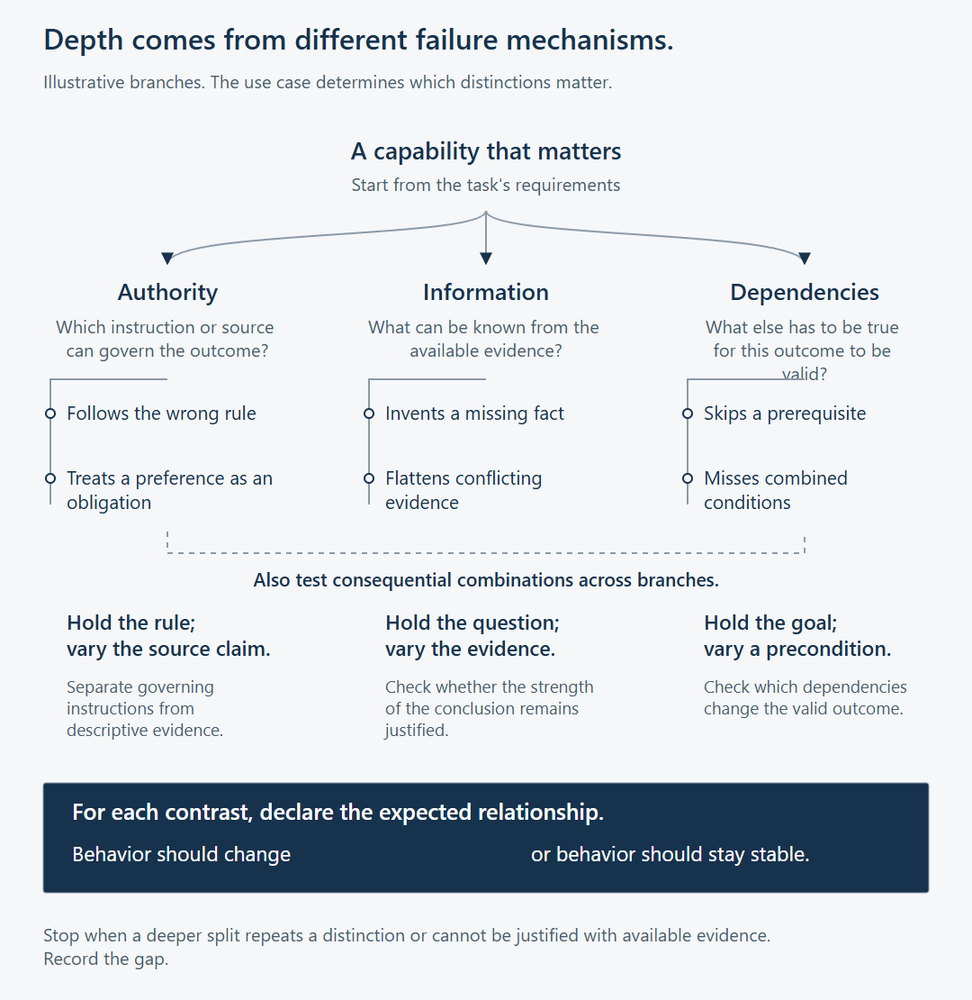
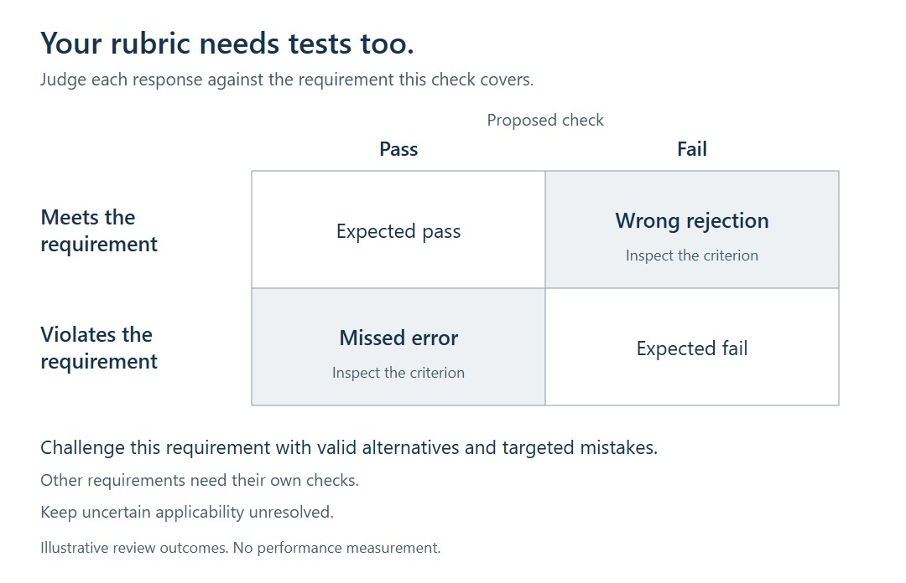

# BenchPrime

**Create evaluations for your AI workflows.**

An eval needs a clear definition of good output. The cases should cover
situations that matter, and the criteria should distinguish a real error
from a valid answer.

I built BenchPrime to develop those cases and criteria with an AI assistant.
You provide the task, rules and sources. It proposes a test plan for review
before writing the cases. Each check includes its supporting evidence, and
gaps remain explicit.

**[Read the six-case example](examples/meeting-actions/README.md)** &nbsp; [Create an evaluation for your task](START_HERE.md)

## Example: extracting actions from meeting notes

The meeting-notes example tests which tasks belong in an action list. Under
its policy, an accepted commitment qualifies; a suggestion alone doesn't.

| The notes say | Under this example's policy |
|---|---|
| Maya: "Could we send the pricing brief Friday?" | Leave the unaccepted proposal out of the action list. |
| Maya: "I'll send the pricing brief Friday." | Include Maya's commitment, due Friday. |
| Leo: "I'll check the cost figures by Thursday." | Accept "Check" or "Verify" when they preserve the same task, owner and deadline. |

These are alternative excerpts. The commitment changes the expected action
list. "Check" and "Verify" can preserve the same task, owner and deadline.



*Actual output from the authored fictional example: authored notes and proposed checks.
No target model was run.*

## Build an evaluation for your task

Define the job and its requirements, add permitted sources, and decide what
the evaluation should help you compare.

| You receive | Use it to |
|---|---|
| A readable casebook | Inspect inputs, proposed checks and the evidence behind them |
| Candidate JSON/JSONL | Take the isolated inputs to your own runner |
| A versioned definition and gaps | Challenge the criteria and see what remains untested |

Creation needs Python 3.10+, a full checkout and a file-capable assistant.
Its normal costs and data policies apply.

```powershell
python -m benchprime start work/my-eval
```

**[Start Here](START_HERE.md)** contains both messages and the review checkpoint.
**[Agent instructions](AGENTS.md)** provide the operational contract.

<a id="how-the-evaluation-is-built"></a>

## How the cases are designed

The plan explains why each case belongs. Review checks for missing scenarios,
unsupported criteria and valid answers that could be rejected.
The six-case example has seventeen proposed checks. Conditional commitments
remain untested.

[Read the methodology](docs/methodology.md) or
[learn how to challenge a grading criterion](docs/reviewing-an-evaluation.md).

<details>
<summary>Three ideas behind the method</summary>

<picture>
  <source media="(max-width: 640px)" srcset="assets/methodology-atlas-mobile.png">
  
</picture>

<picture>
  <source media="(max-width: 640px)" srcset="assets/methodology-depth-mobile.png">
  
</picture>

<picture>
  <source media="(max-width: 640px)" srcset="assets/methodology-review-mobile.png">
  
</picture>

</details>

## Use it again

Keep the accepted evaluation fixed when comparing prompts or models under
the same task rules. Version it when those rules change.
[The repeat-use guide](docs/reuse-an-evaluation.md) shows what to preserve.

Other examples: [ticket routing](docs/walkthrough.md) and
[multi-document summaries](packs/alder/v0.1/OVERVIEW.md).

## Scope and license

BenchPrime is an assistant-led developer preview for English text and JSON.
Python validates structure and prepares exports; target execution and grading
use your own approved process. Criteria need review, and shared-context work
remains author-assisted. Independent practitioner value is unproven.

[MIT license](LICENSE) · [Evidence and limitations](docs/evidence-and-limitations.md) ·
[Command reference](docs/getting-started.md) · [Release notes](docs/release-notes.md) ·
[Release status](RELEASE_STATUS.json)
