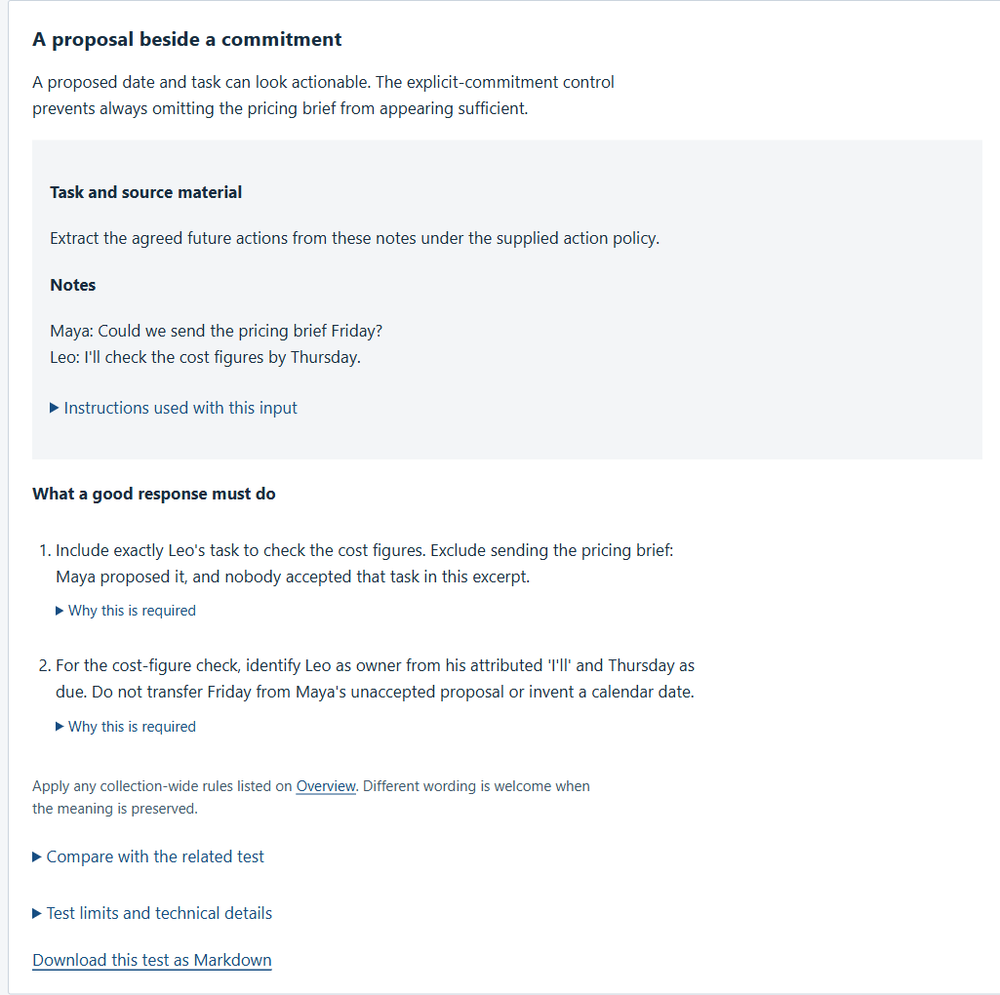
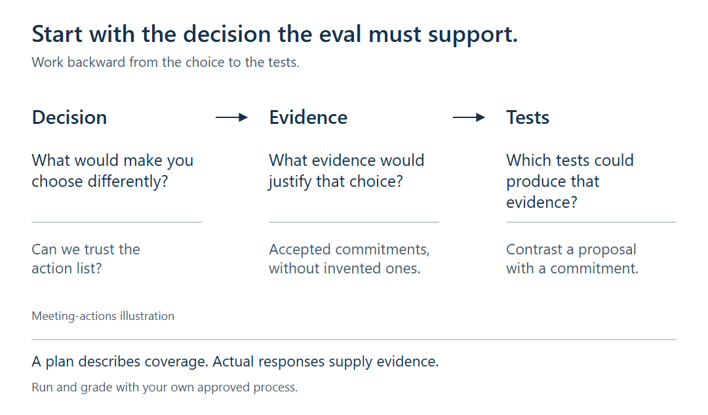
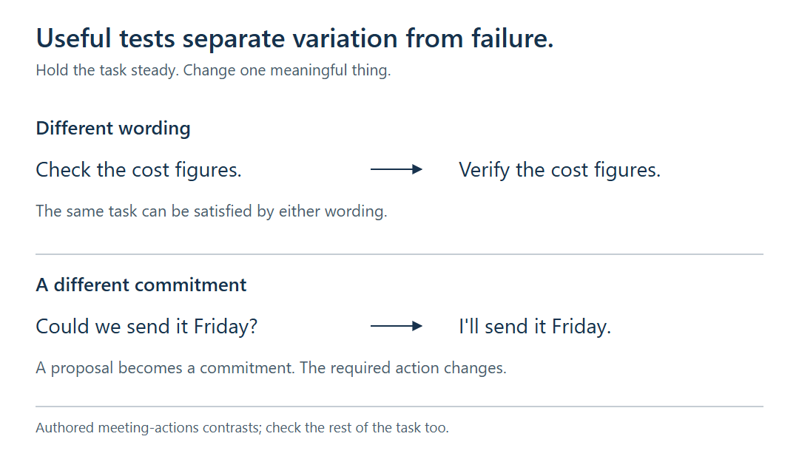
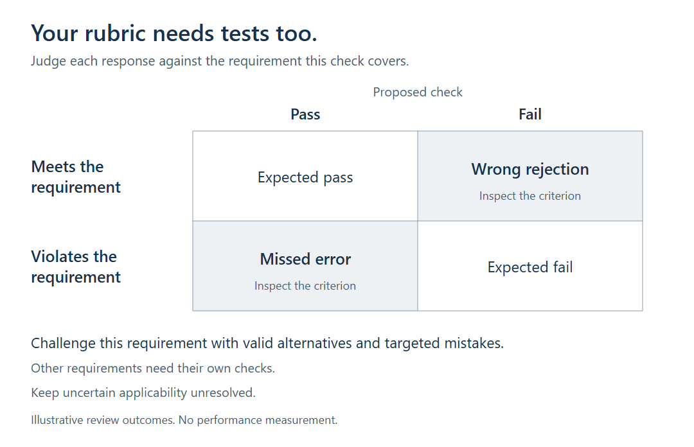

# BenchPrime

**Create evals for the work you need AI to do.**

Describe the task, provide its rules and add permitted sources. BenchPrime
guides your AI assistant through a test plan, cases and grading criteria,
then turns them into files you can inspect and use.

**[Create your first evaluation](START_HERE.md)** &nbsp; [See an example](examples/meeting-actions/README.md)



*An actual casebook from the authored fictional meeting-actions example.
It contains authored notes and proposed checks. No target model was run.*

## From your task to an evaluation

| You bring | You get |
|---|---|
| The job your AI should do | A test plan with categories, scenarios and reasons for including them |
| The rules and sources it must follow | Cases and proposed checks tied to those requirements |
| The decision you need to make | A readable casebook, candidate inputs and explicit coverage gaps |

Use Python 3.10+ from a full checkout:

```powershell
python -m benchprime start work/my-eval
```

Fill in the generated `task.md`, add your sources, and give `KICKOFF.md` to a
file-capable assistant. **Review the test plan before it creates the cases.**
The [first-session guide](docs/first-session.md) walks through the handoff.

## How the evaluation is built

I built BenchPrime to make the reasoning behind an evaluation visible:
why these cases, why these checks, and what is still missing.

- **Test meaningful differences.** A proposed meeting action and an accepted
  commitment should produce different results.
- **Allow valid alternatives.** "Verify the cost figures" can satisfy the
  same requirement as "Check the cost figures."
- **Keep gaps visible.** The small meeting example leaves conditional
  commitments untested. A coverage gap stays a gap.

[Read the methodology](docs/methodology.md) or
[learn how to challenge a grading criterion](docs/reviewing-an-evaluation.md).

<details>
<summary>Three ideas behind the method</summary>

<picture>
  <source media="(max-width: 640px)" srcset="assets/methodology-atlas-mobile.png">
  
</picture>

<picture>
  <source media="(max-width: 640px)" srcset="assets/methodology-depth-mobile.png">
  
</picture>

<picture>
  <source media="(max-width: 640px)" srcset="assets/methodology-review-mobile.png">
  
</picture>

</details>

## Use it again

Keep the accepted evaluation fixed when comparing prompts or models under
the same task rules. Version it when those rules change.
[The repeat-use guide](docs/reuse-an-evaluation.md) shows what to preserve.

Other examples: [ticket routing](docs/walkthrough.md) and
[multi-document summaries](packs/alder/v0.1/OVERVIEW.md).

## Scope and license

BenchPrime is an assistant-led developer preview for English text and JSON.
Python validates structure and prepares exports; target execution and grading
use your own approved process. Criteria need review, and shared-context work
remains author-assisted. Independent practitioner value is unproven.

[MIT license](LICENSE) · [Evidence and limitations](docs/evidence-and-limitations.md) ·
[Command reference](docs/getting-started.md) · [Release status](RELEASE_STATUS.json)
